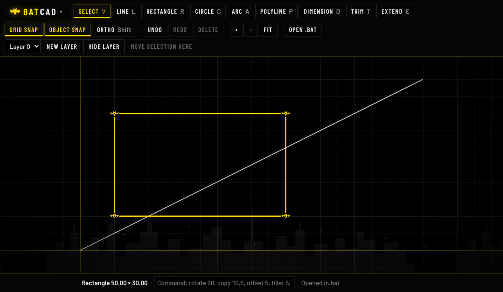

# BatCAD

*“It’s not the CAD we deserve… it’s the CAD we need.”*

**Precision in the dark.**

A fast, minimal 2D CAD drafting tool that runs entirely in your browser: one HTML file, no build step, no install. Black canvas, yellow highlights, nothing in the way. Opens and saves DXF, so it works with AutoCAD-class software.

## Features

- **Drawing tools:** line, rectangle, circle, arc, polyline, dimension
- **Editing:** select, trim, extend, plus a command line for precise input (rotate, copy, offset, fillet, and more; type `help`)
- **Snaps and constraints:** grid snap, object snap, ortho
- **Layers:** per-layer visibility, locking, dashed linetypes and line weights
- **Units:** work in millimetres or inches; geometry is always stored in mm
- **Grips:** select an object and drag its winged-blade grips to reshape it
- **DXF:** open `.dxf` files and export drawings as `.dxf` (lines, arcs, circles, polylines, dimensions, layers, units); polyline arcs become true arcs, blocks are flattened into groups, splines and ellipses become polylines, and text and hatches are skipped with a note
- **Export:** save drawings as `.bat` files or export clean `.svg`
- **Touch friendly:** works on phones and tablets as well as desktop

### Keyboard shortcuts

| Key | Tool | Key | Tool |
|-----|------|-----|------|
| `V` | Select | `D` | Dimension |
| `L` | Line | `T` | Trim |
| `R` | Rectangle | `E` | Extend |
| `C` | Circle | `/` | Command line |
| `A` | Arc | `P` | Polyline |

## The look

BatCAD is a visual reskin built around a classic dark, noir mood:

- Pure black background with near-black panels (always dark, no light theme)
- Yellow accent for selection, active tools, and the origin axes
- Condensed, uppercase, sharp-cornered controls with a soft glow on hover
- A subtle vignette and a faint city-skyline silhouette along the bottom of the canvas
- A shuriken-bat logo and winged-blade selection grips

## Running it

Open `index.html` in any modern browser. To host it, serve the repository root as static files (for example with GitHub Pages).

## File format

Drawings are saved as `.bat` files. A `.bat` file is plain JSON: `{ "format": "batcad", "version": 1, ... }`.

> **Note for Windows users:** `.bat` is also the extension for Windows batch scripts. These files are data, not scripts. Open them from inside BatCAD rather than double-clicking them.

Drawings saved by NinjaCAD (`.nja`, format `ninjacad`) still open in BatCAD, and your autosaved NinjaCAD drawing is picked up automatically.

DXF import and export are available alongside it (R14 ASCII DXF, readable by AutoCAD-class software). The DXF code is adapted from KADlite.

## Credits and origin

BatCAD is a **fork of [NinjaCAD](https://github.com/withshalom/ninja)** by Shalom / WithShalom Studios. NinjaCAD is the source of all the drawing, editing, snapping, layer, and file-handling code. BatCAD changes the look and feel and a few names; the engine is NinjaCAD's.

Changes from NinjaCAD:

| | NinjaCAD | BatCAD |
|---|---|---|
| Name and logo | NinjaCAD, four-point star | BatCAD, shuriken-bat mark |
| Theme | Dark and light | Pure black only |
| Accent | Red | Yellow |
| Selection grips | Ninja stars (shurikens) | Winged blades |
| File extension | `.nja` | `.bat` |
| Typography | Barlow | Barlow Condensed, uppercase controls |

## License

Copyright © WithShalom Studios. This project is a fork of NinjaCAD; refer to the upstream repository for its terms.
